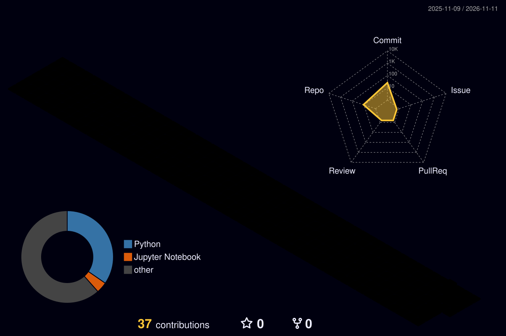

<!-- =========================================================
     PRAGYA SINGH | FUTURISTIC GITHUB PROFILE
     Repository name must be exactly: PragyaSingh1707522
     Files needed alongside this README:
       assets/tech-globe.svg
       assets/terminal-about.svg
       .github/workflows/snake.yml
       .github/workflows/profile-3d.yml
========================================================== -->

 

  

---

## ◈ ABOUT ME

<table>
<tr>
<td width="50%" align="center" valign="middle">

</td>
<td width="50%" valign="middle">

### Hi, I'm Pragya Singh 👋

I'm a software engineer with hands-on full-stack experience in React.js, Node.js and Express.js, and a growing focus on AI-powered applications. I enjoy shipping production features, optimising performance and building reliable systems.

- 🎓 Integrated M.Sc. in Mathematics and Computing at **BIT Mesra** (CGPA 8.87)
- 💼 SDE Intern at **Aarvasa**: cut page load time by 30% and API response times by 25%
- 🤖 Building RAG pipelines and LLM applications with FastAPI and Qdrant
- 🧩 800+ coding problems solved across competitive programming platforms
- 🤝 Open to software engineering opportunities and collaboration

</td>
</tr>
</table>

---

## ◈ TECH STACK — MY DIGITAL UNIVERSE

<table>
<tr>
<td width="50%" align="center" valign="middle">

 
CONNECTING IDEAS • CODE • TECHNOLOGY
</td>
<td width="50%" valign="middle">

**Languages** 

**Frontend** 

**Backend & APIs** 

**Databases** 

**AI / ML** 

**Tools & Deployment** 

</td>
</tr>
</table>

---

## ◈ EXPERIENCE

### 💼 SDE Intern — Aarvasa (LiveLink) · 2026

- Built and shipped **15+ responsive full-stack features** with React.js and Node.js, reducing page load time by **30%**
- Designed **20+ reusable UI components** using React hooks and state management, cutting duplicate frontend code by an estimated **40%**
- Resolved **8 performance bottlenecks** through API optimisation and MongoDB query indexing, improving response times by **25%**
- Integrated **10+ RESTful API endpoints** with Express.js for real-time data updates without full page reloads
- Delivered **12+ features** across two-week agile sprints and managed Git version control and code reviews for a team of 5 across 8 releases

---

## ◈ FEATURED PROJECTS

<table>
<tr>
<td width="50%" valign="top">

### 🛡️ Nexaura AI
**Intelligent Compliance & Risk Intelligence.** A full-stack platform with a hybrid search and RAG pipeline (Qdrant, BGE embeddings, BM25, Reciprocal Rank Fusion) across 4 retrieval strategies, citation-based response verification, 17 REST APIs and 25 reusable components. Includes a 42-class NLP model trained on 21K+ annotations, 4 Docker services and 22 passing tests.

`Python` `FastAPI` `React` `RAG` `LLMs` `PostgreSQL` `Docker`

[↗ View repository](https://github.com/PragyaSingh1707522/Nexaura-AI)

</td>
<td width="50%" valign="top">

### 🌐 INDIA ALL
**Full-stack B2B commodity trading platform** with 109 React components, a 32-product catalogue, 69 REST endpoints and 7 MongoDB models. Features JWT auth, RBAC, token rotation, MFA, English/Spanish/Portuguese localisation (279 keys per language), Vercel deployment and 37/37 passing backend tests.

`MongoDB` `Express` `React` `Node.js` `JWT` `Vercel`

[↗ View repository](https://github.com/PragyaSingh1707522/India-All)

</td>
</tr>
<tr>
<td width="50%" valign="top">

### 💹 Finance Full-Stack Web App
A finance-oriented web application built with Flask and SQL.

`Python` `Flask` `SQL` `HTML`

[↗ View repository](https://github.com/PragyaSingh1707522/Finance)

</td>
<td width="50%" valign="top">

### 🔐 Cryptographic Algorithm Detection
A project focused on identifying cryptographic algorithms from input data.

`Python` `Cryptography`

[↗ View repository](https://github.com/PragyaSingh1707522/Cryptographic-Algorithm-Detection)

</td>
</tr>
<tr>
<td width="50%" valign="top">

### 🦺 Construction Site Safety — PPE Detection
A computer vision project focused on personal protective equipment detection.

`Python` `Computer Vision` `Jupyter Notebook`

[↗ View repository](https://github.com/PragyaSingh1707522/Construction-Site-Safety)

</td>
<td width="50%" valign="top">

### ⚙️ Industrial Machinery Defect Detection
A Python project exploring automated detection of industrial machinery defects.

`Python` `Machine Learning`

[↗ View repository](https://github.com/PragyaSingh1707522/Industrial-Machinery-Defect-Detection)

</td>
</tr>
</table>

---

## ◈ LEADERSHIP & ACHIEVEMENTS

| | |
|---|---|
| 🧑‍🤝‍🧑 **Joint Secretary**, Society of Data Science, BIT Mesra (Jan 2023 – Present) | Organised data science workshops, coding events and speaker sessions, leading 30+ members |
| 🧮 **800+ coding problems** solved | Across multiple competitive programming platforms |
| 🏅 **IEEE Mega Project** | Top 5 ranks out of 40+ participants |
| 🎖️ **NTSE** | Qualified Stage 1 of the National Talent Search Examination |

---

## ◈ HOW I WORK

| Principle | Approach |
|---|---|
| 🧩 Break it down | Turn complex problems into small, testable steps |
| ✨ Build with intent | Prioritise useful features and clear implementation |
| 🔁 Iterate | Test, learn from feedback and improve |
| 🤝 Collaborate | Use Git workflows, code reviews and clear communication |

---

## ◈ GITHUB ANALYTICS

 

 

---

## ◈ CONTRIBUTION DIMENSION

 

<picture>
  <source media="(prefers-color-scheme: dark)" srcset="https://raw.githubusercontent.com/PragyaSingh1707522/PragyaSingh1707522/output/github-snake-dark.svg" />
  <source media="(prefers-color-scheme: light)" srcset="https://raw.githubusercontent.com/PragyaSingh1707522/PragyaSingh1707522/output/github-snake.svg" />
  
</picture>

---

## ◈ CURRENTLY EXPLORING

- 🤖 RAG systems, LLM applications and vector databases
- 🧠 Machine learning and NLP model experimentation
- 🌐 Scalable full-stack architecture with FastAPI, Node.js and React
- 🚀 CI/CD with GitHub Actions and containerisation with Docker

> “Great things are done by a series of small things brought together.” — Vincent van Gogh

### LET'S BUILD SOMETHING MEANINGFUL.

  

